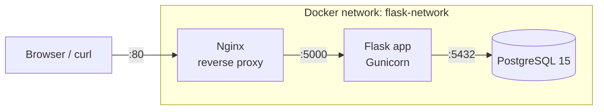

# Flask + Docker + Nginx + PostgreSQL


A small Flask application packaged with a **multi-stage Docker build**, served by **Gunicorn**, fronted by an **Nginx** reverse proxy and backed by **PostgreSQL**, all orchestrated with Docker Compose and deployed through a **Jenkins** pipeline.

## Architecture



Only Nginx is published to the host. Flask and PostgreSQL are reachable only inside the private Docker network.

## Endpoints

| Endpoint | Response | Purpose |
|----------|----------|---------|
| `GET /` | `Hello from Docker Multi-Stage!` | Confirms the app is serving |
| `GET /health` | `{"status": "ok"}` | Liveness check (used by Docker and Jenkins) |
| `GET /db` | `{"status": "ok", "database": "connected"}` or HTTP 503 | Confirms the app can reach PostgreSQL |

## Quick start

**Requirements:** Docker with the Compose plugin (`docker compose version`).

```bash
git clone https://github.com/iamohsin1273/flask-docker-app.git
cd flask-docker-app

cp .env.example .env        # then edit the password
docker compose up -d --build
```

Try it:

```bash
curl http://localhost/          # Hello from Docker Multi-Stage!
curl http://localhost/health    # {"status":"ok"}
curl http://localhost/db        # {"database":"connected","status":"ok"}
```

Stop everything:

```bash
docker compose down             # keep the database volume
docker compose down -v          # also delete the database volume
```

## Configuration

Docker Compose reads these from a `.env` file (copy [`.env.example`](.env.example)). Every value has a default so the stack also starts without a `.env`, but **do not use the default password outside local development**.

| Variable | Default | Description |
|----------|---------|-------------|
| `POSTGRES_USER` | `admin` | Database user |
| `POSTGRES_PASSWORD` | `secret` | Database password. Use URL-safe characters, because it is placed inside `DATABASE_URL` |
| `POSTGRES_DB` | `flaskdb` | Database name |
| `HTTP_PORT` | `80` | Host port Nginx is published on |

The Flask container receives a `DATABASE_URL` built from the values above.

## Project structure

```
.
├── app.py                 # Flask application (/, /health, /db)
├── tests/test_app.py      # pytest tests (run inside Docker, see below)
├── requirements.txt       # Runtime dependencies
├── requirements-dev.txt   # Adds pytest
├── Dockerfile             # Multi-stage build: builder, test, runtime
├── docker-compose.yml     # Nginx + Flask + PostgreSQL
├── nginx.conf             # Reverse proxy configuration
├── Jenkinsfile            # Test, build, deploy, smoke test
├── .env.example           # Configuration template
└── .dockerignore
```

## Docker image

The [`Dockerfile`](Dockerfile) has three stages:

| Stage | Purpose |
|-------|---------|
| `builder` | Installs Python dependencies into a virtualenv at `/opt/venv` |
| `test` | Extends `builder`, installs pytest and runs the tests. Never ends up in the final image |
| `runtime` | Slim final image: copies only the virtualenv and `app.py` |

The runtime image runs as an unprivileged user, serves with Gunicorn (2 workers) and has a built-in health check that calls `/health`.

## Running the tests

Tests run inside Docker, so you do not need Python installed locally:

```bash
docker build --target test -t flask-app-test .
```

The build fails if any test fails. The Jenkins pipeline uses the same command.

To run them without Docker:

```bash
python -m venv .venv && source .venv/bin/activate
pip install -r requirements-dev.txt
pytest
```

## Jenkins pipeline

The [`Jenkinsfile`](Jenkinsfile) defines four stages:

1. **Test** builds the `test` image stage, which runs pytest
2. **Build** runs `docker compose build`
3. **Deploy** runs `docker compose up -d --remove-orphans` (the database volume is preserved)
4. **Smoke Test** calls `/health` through Nginx and retries for about a minute

On failure the last 100 log lines of every container are printed.

**Jenkins agent requirements:** Docker and the Docker Compose plugin installed, and the `jenkins` user allowed to use Docker (for example, member of the `docker` group). If you want to change the database password for Jenkins deployments, define `POSTGRES_PASSWORD` as a Jenkins credential and expose it to the pipeline as an environment variable.

## Useful commands

```bash
docker compose ps                    # container status and health
docker compose logs -f flask-app     # follow application logs
docker compose exec postgres-db psql -U admin -d flaskdb
docker compose build --no-cache      # rebuild from scratch
```

## Troubleshooting

| Symptom | Likely cause and fix |
|---------|----------------------|
| `port is already allocated` on port 80 | Another service uses port 80. Set `HTTP_PORT=8080` in `.env` and use `http://localhost:8080` |
| `502 Bad Gateway` right after start | Flask is still starting. Wait a few seconds and check `docker compose ps` |
| `/db` returns 503 | PostgreSQL is not ready or the credentials changed. Check `docker compose logs postgres-db` |
| Changed `POSTGRES_PASSWORD` but login still fails | PostgreSQL only reads the password when the volume is first created. Run `docker compose down -v` to reset (this deletes the data) |

## Notes for production

This project is a learning and demo setup. Before using the pattern in production, consider:

- Storing secrets in a secret manager instead of a `.env` file
- Terminating TLS (HTTPS) at Nginx or a load balancer
- Pinning base images by digest and scanning them for vulnerabilities
- Using a managed PostgreSQL service with backups

## License

No license file is included yet. Add one (for example MIT) if you want others to reuse this project.
